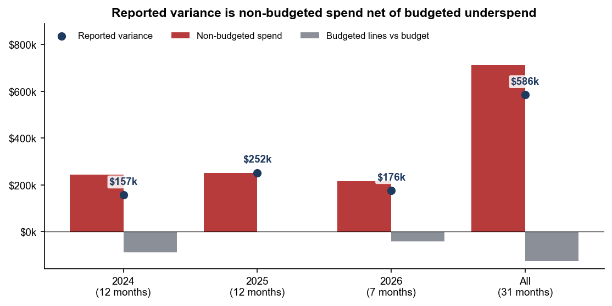
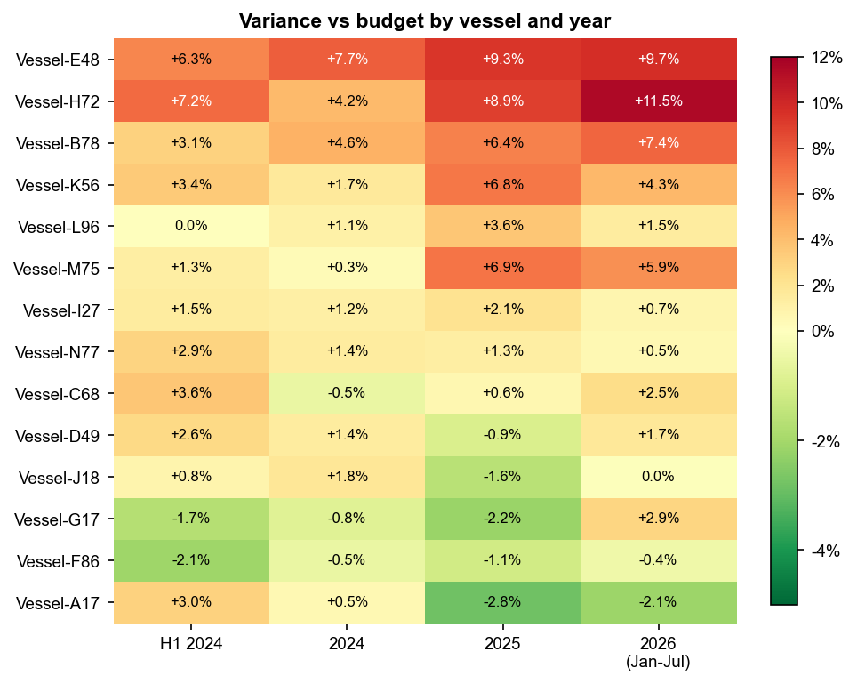
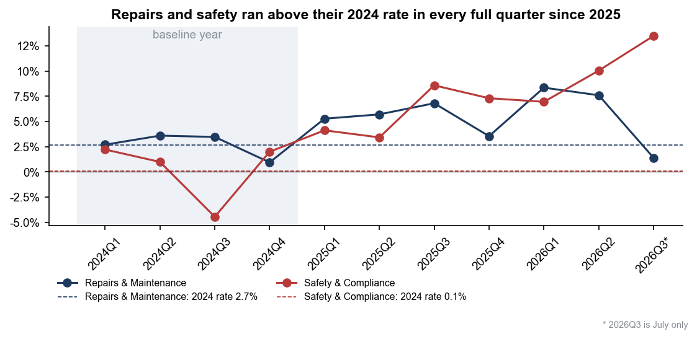
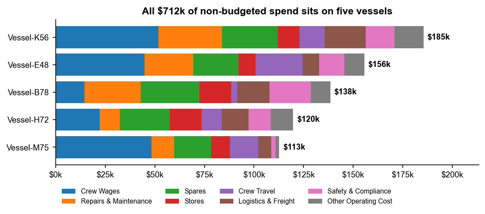
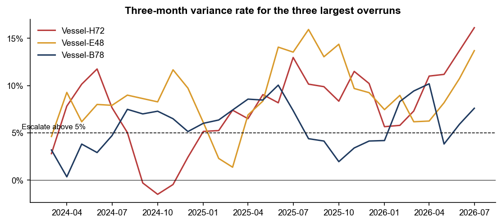
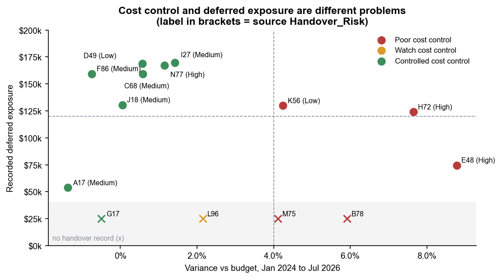
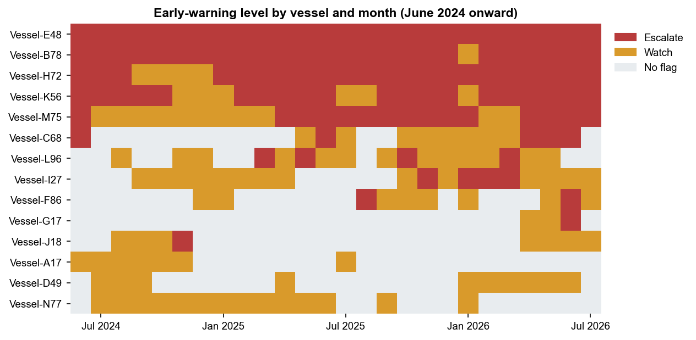
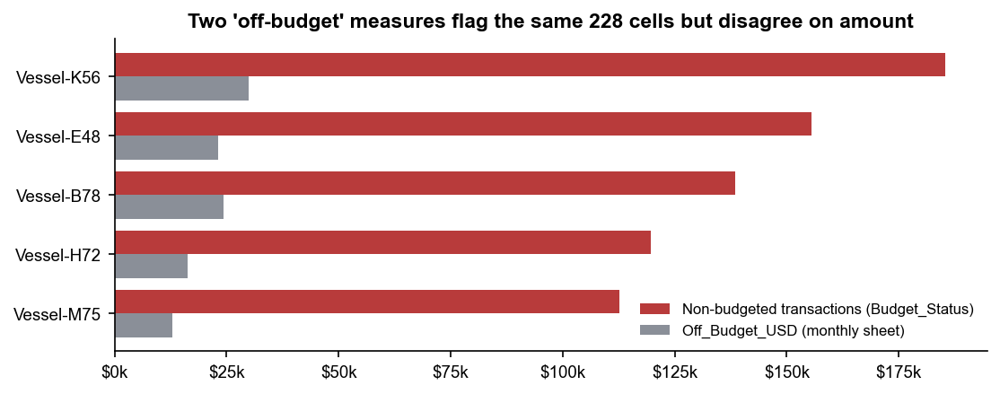

# Evidence and limitations (D3)

The evidence behind each conclusion in the management summary, what it rests on, and what the data cannot show. Figures come from `GNMTC_Vessel_Cost_Analysis.xlsx`, which `py -3 -m analysis.run_all` rebuilds from the source workbook. The data is synthetic.

## 1. How the evidence was produced

1. **Validated the source before using it.** Sixteen checks run on every build (`Reconciliation` sheet). Thirteen pass. Three are known issues the analysis works around, and none is a failure:
   - `Off_Budget_USD` does not reconcile to non-budgeted transactions.
   - K56's issue counts contradict each other.
   - Four vessels have no handover record.

   Column-level profiling and trust ratings are in `GNMTC_Data_Quality_Assessment.xlsx`.
2. **Built one analytical table** (`Fact_Monthly`, also `analytical_dataset.csv`). It has one row per vessel, month and cost category, with transaction spend split into budgeted and non-budgeted parts. Transactions match monthly actuals to within $0.02 in every cell.
3. **Recomputed everything from that table.** The summary sheets are Excel formulas over it. After Excel recalculated the file, `analysis/verify_workbook.py` checked all 323 formulas: none returned an error, and every total, rate and cost band matched the Python build.
4. **Labelled every claim.** *Fact* means computed directly from the source. *Interpretation* means a reasonable reading that needs more evidence. *Open* means the data cannot answer it.

The identity that drives most findings holds on every row:

**variance = non-budgeted spend + (budgeted lines − budget)**, which for the fleet is **$585,992 = $711,719 + (−$125,727)**.

This is an accounting identity, true by construction. It shows how the overrun splits; it does not show that the non-budgeted spend caused it (E21).

## 2. Evidence register

| ID | Claim | Figure | Type | Confidence | Caveat |
|---|---|---|---|---|---|
| E01 | The fleet spent more than budget over the 31 months. | Variance $585,992 (+2.4%) on a $24,765,499 budget. | Fact | High | Budget version (original or revised) is not stated. |
| E02 | Fleet variance equals non-budgeted spend plus the result on budgeted lines, and budgeted lines as a whole came in under budget (an accounting identity, not a cause; see E21). | Non-budgeted $711,719; budgeted lines -$125,727; sum equals the variance. | Fact | High | The identity holds by construction. It relies on the Budget_Status flag, whose definition is unconfirmed. |
| E03 | All non-budgeted spend sits on five vessels, which carry most of the net overrun. | E48, H72, B78, K56, M75: $711,719 non-budgeted; 86% of net fleet variance. | Fact | High | — |
| E04 | The monthly overrun pace rose each year. | $13,110 per month in 2024, $21,039 in 2025, $25,172 in 2026 (Jan-Jul). | Fact | Medium | 2026 is seven months; seasonality cannot be tested with 31 months. |
| E05 | The two worst vessels were already the worst in the first half of 2024 and stayed over budget. | H72 +7.2% and E48 +6.3% in H1 2024; over budget in 28 and 29 of 31 months. | Fact | High | — |
| E06 | Repairs and safety costs deteriorated after 2024. | Repairs +2.7% / +5.3% / +7.1%; safety +0.1% / +6.0% / +9.3% (2024 / 2025 / 2026). | Fact | High | Why it rose is not in the data (see E20). |
| E07 | Crew wages look on budget only because non-budgeted wages offset budgeted underspend. | Variance $2,927; non-budgeted $181,800; budgeted lines -$178,873. | Fact | High | Whether the non-budgeted wages replaced budgeted wages (relief crew) is not shown. |
| E08 | K56's reported variance understates its unbudgeted spend. | Variance $86,887; non-budgeted $185,428; budgeted lines -$98,540. | Fact | High | — |
| E09 | L96's overrun is budget drift, not unbudgeted spend. | Variance $52,125, no non-budgeted spend; crew wages $33,094. | Fact | High | — |
| E10 | Off_Budget_USD does not measure the same thing as non-budgeted transactions. | $106,514 against $711,719; same 228 cells, amounts equal in one. | Fact | High | What Off_Budget_USD is meant to measure is an open question for the data owner. |
| E11 | The Handover_Risk label does not follow deferred exposure or cost control. | Correlation of deferred exposure with variance -0.29; K56 labelled Low with the most non-budgeted spend; D49 labelled Low with $168,702 deferred. | Fact | Medium | Scoring rule for the label is not supplied; ten vessels only. |
| E12 | Four vessels have no handover record, including two with unbudgeted spend. | B78, M75, L96, G17; $251,089 non-budgeted spend on B78 and M75. | Fact | High | Missing rows are treated as unknown, not as zero risk. |
| E13 | K56's issue counts contradict each other. | Open 4, overdue 5. | Fact | High | Assumes overdue issues are a subset of open issues. |
| E14 | Recorded deferred exposure is unvalidated and is reported separately from cost performance. | $1,336,384 across ten vessels. | Open | Low | No estimation method or as-of date; not added to, netted against or compared with the overrun (a balance of work against a 31-month cost flow). |
| E15 | Hotspot spend is concentrated in a few invoice themes. | H72 safety: Survey preparation 39%, Lifesaving appliances 35%, Fire safety equipment 26%. E48 crew travel: Crew change travel 52%, Emergency crew travel 48%. | Interpretation | Medium | Themes describe what was bought, not why it was needed. |
| E16 | On 2026 months not used to choose the rule, the selected rule scored higher than the baselines, but the gap is within sampling noise. | Precision 76% (16 of 21 flags), recall 64% (16 of 25 bad outcomes), false alarms 16%; last-month baseline 60% / 48%; logistic regression 65% / 52%. Base rate of bad outcomes 45%. | Interpretation | Low | 56 vessel-months, mostly from five persistent vessels. A vessel-clustered bootstrap gives precision 40-100% and recall 33-86% for the rule, overlapping both baselines. Windows overlap; synthetic data. |
| E17 | The rule escalates all five unbudgeted-spend vessels in the first month it can score, so how much earlier the signal was visible cannot be tested. | First escalation: H72 Jun 2024, E48 Jun 2024, B78 Jun 2024, K56 Jun 2024, M75 Jun 2024. | Fact | High | June 2024 is the first month with six months of history. With three months of history the same triggers fire for B78, E48, K56 and M75 in March 2024 and H72 in April 2024. |
| E18 | Urgent spend is a small share of spend and almost entirely freight. | $1,043,294 (4.1% of spend); 513 of 573 urgent lines are logistics. | Fact | Medium | Criteria for marking a purchase urgent are not supplied. |
| E19 | Vessel age, size and type do not explain the overruns in this fleet. | Overruns are vessel-specific: J18 (offshore, age 20) is on budget while E48 (offshore, age 19) is the worst. | Interpretation | Low | Fourteen vessels is too few to test vessel attributes statistically. |
| E20 | The cause of the repairs and safety deterioration cannot be determined from this data. | No maintenance history, defect, dry-dock, survey schedule or purchase-order data. | Open | n/a | Needs planned-maintenance and defect records to explain. |
| E21 | Non-budgeted spend is extra spend on top of budget, not budgeted work coded as non-budgeted. | Budgeted lines are under budget by $125,727 while $711,719 is non-budgeted; crew wages shows $181,800 non-budgeted against $178,873 of budgeted underspend. | Open | n/a | The data cannot separate extra spend from recoding or replacement of budgeted work. Needs the approvals behind the non-budgeted lines. |

The same register, with the workbook sheet behind each figure, is the `Evidence_Register` sheet.

## 3. Supporting charts

**Non-budgeted spend is larger than the overrun every year (E02, E04).** Budgeted lines were under budget in 2024 and 2026, and roughly on budget in 2025.

**The worst vessels were visible from the first half of 2024 (E05).** H72, E48 and B78 got worse each year. M75 jumped in 2025. A17, F86 and G17 stayed near or under budget.

**Repairs and safety ran above their 2024 rates in every full quarter from 2025 (E06).** July 2026 repairs (+1.4%) is a single month, not a reversal.

**All non-budgeted spend sits on five vessels, spread across every category (E03).** Crew wages is the largest single block on K56, E48 and M75.

**The three largest overruns spent most months above the 5% escalation line (E05, E17).**

**Cost control and recorded deferred exposure pick out different vessels (E11, E12).** The source risk label, in brackets, follows neither.

**The early-warning rule escalated the five problem vessels throughout and rarely touched the controlled ones (E16, E17).**

**The two off-budget measures flag the same cells but disagree by $605,205 (E10).**

## 4. Limitations

**About the data**

- **Synthetic data.** The values were generated for an assessment. The findings show what this file says, not how a real fleet behaves.
- **Short history.** Thirty-one months, with 2026 ending in July. Seasonality, dry-dock cycles and year-end budget effects cannot be separated from trend. Every year-on-year comparison uses rates or monthly pace.
- **The budget is not described.** Nothing says whether `Budget_USD` is the original or revised budget. A revised budget would understate the original miss.
- **Two flags have no stated rules.** `Budget_Status` and `Urgency` come with no criteria. Every non-budgeted figure assumes the flag is applied consistently.
- **The handover register is thin.** It covers 10 of 14 vessels and has no dates, no estimation method and no rule for the risk label. One vessel's counts contradict each other.

**About the method**

- **Thresholds were picked while exploring all 31 months.** That applies to the cost bands, the deferred-exposure cut-off and the early-warning values. The `Assumptions` sheet (last tab of `GNMTC_Vessel_Cost_Analysis.xlsx`) states each one, and the cost-band thresholds can be changed there.
- **Early-warning results are a small later-period test.** The 2026 test is 56 vessel-months, its outcome windows overlap, and five persistent vessels supply most of the bad outcomes. The thresholds were set with sight of all months, so "held out" means only "not used to choose between candidate rules". See `Early_Warning_Prototype.md`.
- **Correlations are descriptive.** With 14 vessels, no vessel-level statistic is significant in a formal sense. The findings rest on totals and repeated monthly patterns, not on tests.

## 5. Unresolved issues and questions for the data owner

| Issue | Why it matters | Question |
|---|---|---|
| `Off_Budget_USD` against `Budget_Status` | The two differ by $605,205; any unbudgeted-spend KPI depends on the answer | Is off-budget the whole transaction or only its unplanned part? Which measure is official? |
| K56 issue counts | Overdue (5) exceeds open (4) | Are overdue issues a subset of open issues? Which count is wrong? |
| Missing handover records | B78 and M75 have $251,089 of unbudgeted spend and no handover view | Why do B78, G17, L96 and M75 have no row? |
| Deferred exposure | $1.34 million is recorded with no method or date | How was it estimated, and as of when? Is any of it already in actuals? |
| Handover_Risk label | It follows neither cost nor exposure | What rule assigns Low, Medium and High? |
| Budget version | Affects every variance | Is `Budget_USD` the approved or the latest revised budget? |
| Cause of the repairs and safety rise | Needed to tell planned work from failure-driven cost | Can planned-maintenance, defect, survey and purchase-order records be linked to cost lines? |

## 6. What would change the conclusions

- **If non-budgeted lines are recoded budgeted work (E21),** the net overrun is real but the "leak" reading weakens, and the escalation trigger on non-budgeted spend becomes a coding check.
- **If `Budget_Status` is applied inconsistently,** the five-vessel finding (E03) and the non-budgeted escalation trigger weaken. The variance findings (E01, E04, E05, E06) would still hold.
- **If the budget is a revised budget,** the original miss is larger than reported.
- **If deferred exposure turns out to be already reflected in actuals,** the handover axis overstates what is still outstanding.
- **If maintenance records show the repairs and safety rise was planned work,** such as survey or dry-dock preparation, E06 becomes a budgeting problem rather than a control problem.
